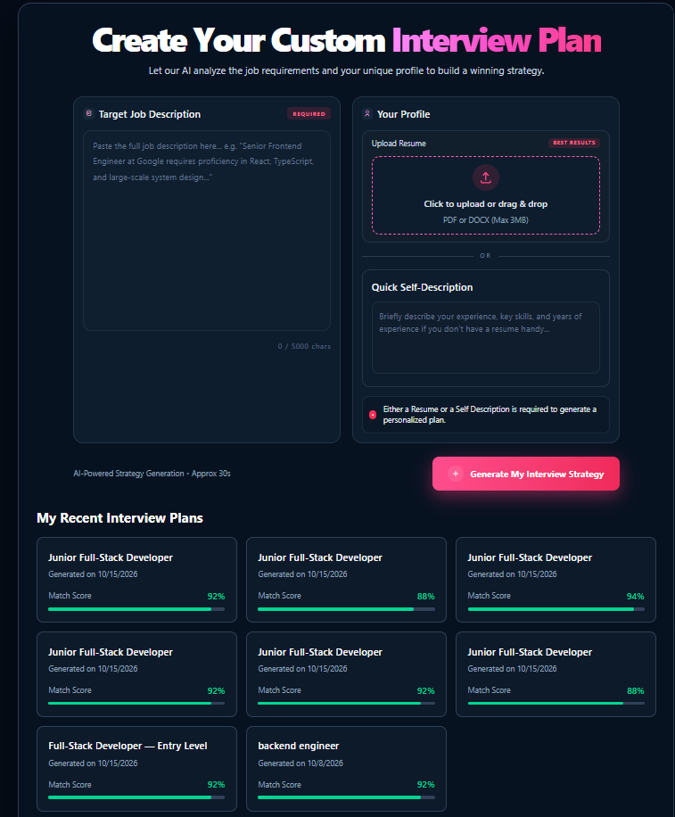
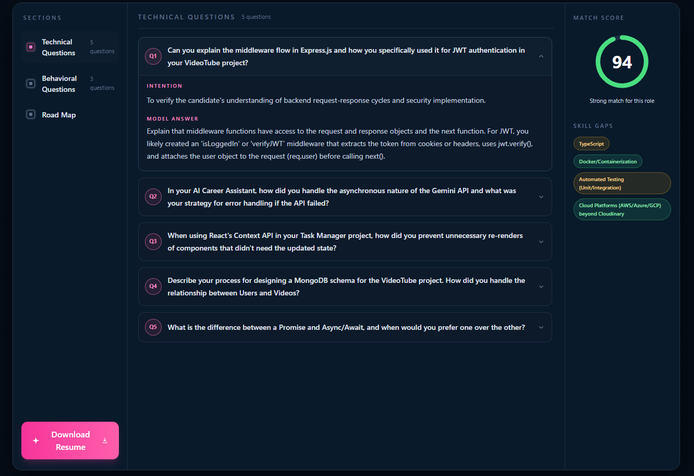

# AI Career Assistant 🚀

An AI-powered career preparation platform that helps candidates prepare for job interviews by analyzing their resume, self-description, and target job description. It generates personalized interview questions, evaluates job compatibility, identifies skill gaps, and creates a preparation roadmap.

## ✨ Features

- **User Authentication:** Register, log in, and log out securely.
- **AI-Powered Interview Preparation:** Generate customized interview reports using a generative AI API.
- **Resume Analysis:** Upload a PDF resume or provide a self-description to personalize your preparation.
- **Job Description Analysis:** Analyze job requirements to tailor interview preparation to a specific role.
- **Technical Interview Questions:** Get relevant technical questions, interviewer intentions, and suggested answers.
- **Behavioral Interview Questions:** Prepare for behavioral interviews with questions and answer guidance.
- **Job Match Score:** View an AI-generated score indicating how well your profile matches the target role.
- **Skill Gap Analysis:** Identify missing skills and understand their severity.
- **Personalized Preparation Roadmap:** Get a day-wise plan with focused topics and actionable tasks.
- **Interview Report History:** Revisit previously generated interview plans from the home page.
- **Responsive UI:** A dark-themed interface built with Tailwind CSS.

## 🛠️ Tech Stack

### Frontend
- React.js
- Vite
- Tailwind CSS
- React Router
- Axios
- React Context API

### Backend
- Node.js
- Express.js
- MongoDB
- Mongoose
- JSON Web Tokens (JWT)
- Cookie Parser
- Multer
- PDF parsing with `pdf-parse`

### AI Integration
- Google Gemini API
- `@google/genai`
- Zod for structured data validation

## 📂 Project Structure

```text
AI-Career-Assistant/
├── backend/
│   ├── src/
│   │   ├── controllers/
│   │   ├── db/
│   │   ├── middlewares/
│   │   ├── models/
│   │   ├── routes/
│   │   ├── services/
│   │   ├── utils/
│   │   ├── app.js
│   │   ├── constants.js
│   │   └── index.js
│   ├── .env.sample
│   └── package.json
│
├── frontend/
│   ├── public/
│   ├── src/
│   ├── package.json
│   ├── vite.config.js
│   └── README.md
│
├── .gitignore
└── Readme.md
```

*The structure above is illustrative; adjust folder names to match your actual repository.*

## ⚙️ Getting Started

### Prerequisites

Make sure you have the following installed:

- Node.js and npm
- MongoDB or a MongoDB Atlas connection
- A Google Gemini API key

### 1. Clone the repository

```bash
git clone https://github.com/udaypartap3511/AI-career-assistant
cd AI-Career-Assistant
```

### 2. Set up the backend

```bash
cd backend
npm install
```

Create a `.env` file in the location expected by your backend configuration.

Example environment variables:

```env
PORT=8000
MONGODB_URI=your_mongodb_connection_string

ACCESS_TOKEN_SECRET=your_access_token_secret
REFRESH_TOKEN_SECRET=your_refresh_token_secret

GOOGLE_GENAI_API_KEY=your_gemini_api_key

CORS_ORIGIN=http://localhost:5173
```

Use the exact variable names expected by your implementation. If your application loads the root `.env` file, place the variables there instead.

Start the backend using the development script configured in `backend/package.json`:

```bash
npm run dev
```

### 3. Set up the frontend

Open another terminal:

```bash
cd frontend
npm install
```

Configure the backend API URL if your Axios configuration uses an environment variable. Otherwise, use the local URL configured in your API service.

Start the frontend:

```bash
npm run dev
```

Open the local URL printed by Vite, usually `http://localhost:5173`.


## 📸 Screenshots

### Home Page

The home page allows users to enter a job description, upload their resume or provide a self-description, and generate a personalized interview preparation plan.



### Interview Report

The interview report page displays AI-generated technical and behavioral questions, suggested answers, a job match score, skill gaps, and a personalized preparation roadmap.



## 🔄 How It Works

1. **Register or log in** to your account.
2. **Provide a job description** for the role you want to target.
3. **Upload your resume PDF** or enter a self-description.
4. **Generate an interview plan.** The backend extracts resume text when a PDF is provided and sends the relevant information to the AI service.
5. **Review your report**, including technical questions, behavioral questions, suggested answers, match score, and skill gaps.
6. **Follow your preparation roadmap** to work on the identified areas.
7. **Revisit previous reports** from your home page.

## 🔐 Security

- Authentication uses JSON Web Tokens.
- HTTP-only cookies are used for access and refresh tokens.
- Environment variables are used for sensitive configuration.
- CORS is configured to allow requests from the frontend origin.

**Important:** Never commit API keys, database credentials, token secrets, or actual `.env` files to GitHub. Keep `.env` files in `.gitignore` and provide example files containing placeholders only.

## 🚧 Future Improvements

- Mock interview sessions with interactive follow-up questions.
- Voice-based interview practice.
- Resume scoring and improvement suggestions.
- Progress tracking across multiple interview reports.
- Downloadable interview reports in PDF format.
- Job application tracking.
- Deployment with production-ready configuration.

## 🤝 Contributing

Contributions and suggestions are welcome.

1. Fork the repository.
2. Create a feature branch.
3. Make your changes.
4. Submit a pull request.

## 📄 License

This project is available for learning and personal development. Add a license file to specify the permissions and conditions for reuse.

---

**Built with React, Node.js, MongoDB, and Google Gemini AI.**